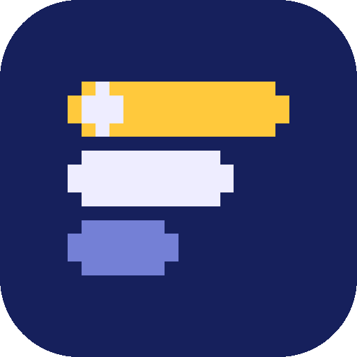
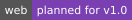
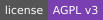

<p align="center">
  
</p>

# saves.fm

<p>
  <!-- Badges are committed SVGs (scripts/badges.py) so they load even when shields.io doesn't; CI is the one live badge. At v0.1.0 the status badge is swapped for docs/badges/release.svg, regenerated on each version bump (see docs/releasing.md) -->
  
  
  
  
  <a href="LICENSE"></a>
  <a href="https://github.com/saves-fm/saves/actions/workflows/ci.yml"></a>
</p>

A Last.fm-style history and stats app for [RetroAchievements](https://retroachievements.org) players. RA already records every unlock with a timestamp; saves.fm keeps that history and turns it into charts, game pages, comparisons with friends, recommendations and a year-end Rewind.

Free and open source (AGPL-3.0). saves.fm is an independent fan project and is not affiliated with RetroAchievements.

**Status:** early setup (v0.1.0). The monorepo, CI and release tooling are in place; the app itself isn't built yet. The full product and technical plan is in [`docs/spec.md`](docs/spec.md).

## Roadmap

Every feature ships on the web first. The iOS and Android apps come last, at full parity.

| Version | Focus |
|---|---|
| [v0.1.0](https://github.com/saves-fm/saves/milestone/1) | Project setup: monorepo, CI, environments, secrets |
| [v0.2.0](https://github.com/saves-fm/saves/milestone/2) | Foundation: design tokens, translation-ready strings, API and generated clients, passkeys, RA verification, share images |
| [v0.3.0](https://github.com/saves-fm/saves/milestone/3) | Data pipeline: backfill, change-triggered polling, sessions, time zones, stat rollups |
| [v0.4.0](https://github.com/saves-fm/saves/milestone/4) | MVP web: sign-up, RA linking, profile, charts, history, settings, data export and deletion |
| [v0.5.0](https://github.com/saves-fm/saves/milestone/5) | Launch readiness: varied backfills, load test, WCAG 2.2 AA audit, monitoring, RA staff demo |
| [v1.0.0](https://github.com/saves-fm/saves/milestone/6) | Public web launch |
| [v1.1.0](https://github.com/saves-fm/saves/milestone/7) | Game pages, global charts, now playing, tags |
| [v1.2.0](https://github.com/saves-fm/saves/milestone/8) | Player 2: follows, compatibility, friends feed |
| [v1.3.0](https://github.com/saves-fm/saves/milestone/9) | Discovery: recommendations and the Finder |
| [v1.4.0](https://github.com/saves-fm/saves/milestone/10) | Rewind, the year-end recap (first one December 2027) |
| [v1.5.0](https://github.com/saves-fm/saves/milestone/11) | Profile cards, yearly goals, supporters |
| [v1.6.0](https://github.com/saves-fm/saves/milestone/12) | Notifications on the web |
| [v1.7.0](https://github.com/saves-fm/saves/milestone/13) | Lists and percentiles |
| [v1.8.0](https://github.com/saves-fm/saves/milestone/14) | Public API, Discord bot, Home Assistant guide |
| [v2.0.0](https://github.com/saves-fm/saves/milestone/15) | iOS and Android apps, push, widgets, watch apps |

## Dev setup

You need Node 24+ (26 recommended, see `.nvmrc`), pnpm 10, and for the mobile app Flutter 3.47 with [Melos](https://melos.invertase.dev) (`dart pub global activate melos`).

```bash
git clone https://github.com/saves-fm/saves.git && cd saves
pnpm install          # web, API and packages
melos bootstrap       # Flutter app
pnpm dev              # web at localhost:5173, API at localhost:8787 (try /v1/health)
```

| Folder | What it is |
|---|---|
| `apps/web` | React + Vite web app |
| `apps/api` | Hono API on Cloudflare Workers (`wrangler dev`) |
| `apps/mobile` | Flutter app for iOS and Android (`cd apps/mobile && flutter run`) |
| `packages/tokens` | Design tokens from [`brand/tokens.json`](brand/tokens.json), shared by web and Flutter |
| `packages/api-schema` | The OpenAPI contract and generated TypeScript and Dart clients |
| `brand` | Logo, icons, fonts and the brand guide ([README](brand/README.md)) |

Before pushing, run what CI runs: `pnpm lint && pnpm typecheck && pnpm test && pnpm build`, plus `melos run analyze --no-select && melos run test --no-select` for Flutter. Releases are cut from a tag; see [`docs/releasing.md`](docs/releasing.md).

## Stack

React + Vite (web), Flutter (iOS and Android), Hono on Cloudflare Workers (API), D1, R2, KV and Queues. Design tokens and the API contract are shared, so the web and mobile apps match screen for screen.
