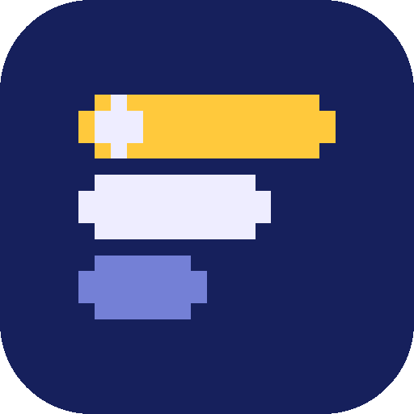

# saves.fm brand assets

> **Where this lives.** The master copy is [`brand/` in saves-fm/saves](https://github.com/saves-fm/saves/tree/main/brand): edit and rebuild there, and [`packages/tokens`](https://github.com/saves-fm/saves/tree/main/packages/tokens) reads `tokens.json` from it. [`saves-fm/.github/brand`](https://github.com/saves-fm/.github/tree/main/brand) is an exact mirror for the org profile. To refresh it, run this from the app repo and commit in both: `rsync -a --delete --exclude build/ --exclude .venv/ brand/ ../saves-fm-github/brand/`

The **chart slots** mark is the official saves.fm logo: three save slots that double as a top-games chart, with number one starred. It's used for the app icon, the website, the GitHub org and social profiles. Use these files rather than redrawing it.

<p align="center"> &nbsp; </p>

Everything here is generated. The pixel grids in [`build.py`](build.py) are the masters: edit them or [`tokens.json`](tokens.json), then rebuild.

```bash
python3 -m venv .venv && .venv/bin/pip install fonttools   # once
.venv/bin/python build.py                                    # marks, icons, lockups, favicons, app icons
node render-social.mjs                                       # social images (needs playwright-core)
```

## Logo

The mark is 16×16 pixel art. Always scale it by whole multiples of 16 px (16, 32, 48, 64…) so the pixels stay crisp.

| File | What it's for |
| --- | --- |
| `saves-mark.svg` | **Master mark** for dark backgrounds (transparent). |
| `saves-mark-light.svg` | Master mark for light backgrounds. |
| `saves-mark-512.png`, `saves-mark-light-512.png` | Transparent PNGs for places that can't take SVG. |
| `saves-icon.svg`, `saves-icon-{1024,512,400}.png` | The mark on a rounded navy tile. README headers, docs, anywhere the logo needs its own background. |
| `saves-icon-light.svg`, `saves-icon-light-512.png` | Rounded tile on mist, for light contexts. |
| `saves-avatar-500.png` | Full-bleed navy square for avatars that crop to a circle (GitHub org, Bluesky, Discord). |
| `saves-lockup.svg` / `-light.svg` (+ PNG) | Horizontal logo + wordmark. The wordmark is outlined, so no font is needed. |
| `saves-lockup-stacked.svg` / `-light.svg` (+ PNG) | Stacked version for square spaces. |

**Clear space:** keep 2 grid pixels (1/8 of the mark's width) clear on every side. **Minimum size:** 16 px for the mark, 96 px wide for the horizontal lockup.

**Don't:** redraw, rotate, add effects or outlines, smooth the pixels, recolor outside the tokens, or put the dark-background mark on a light background (use the `-light` files). Don't pair the mark with console makers' logos or RetroAchievements branding.

## App icons

| File | What it's for |
| --- | --- |
| `app-icon/app-icon-1024.png` | Full-bleed navy square. Source for iOS and Android; the OS applies its own mask. |
| `app-icon/app-icon-light-1024.png` | Light variant (mist background), for iOS light/tinted icon slots and light store art. |
| `app-icon/app-icon-macos-1024.png` | macOS rounded tile with Apple's margin, on a transparent canvas. |
| `app-icon/android-adaptive-foreground-432.png` | Android adaptive icon foreground (xxxhdpi), mark inside the safe zone. Background color: `navy`. |

## Favicons

`favicon/favicon.svg`, `favicon.ico` (16, 32, 48), `favicon-{16,32,48}.png` and `apple-touch-icon-180.png`. The favicon is the mark on a small navy tile, so it reads on both light and dark browser chrome.

## Icon family

Each product area has its own icon on the same 16×16 grid, in `icons/dark/` (for dark backgrounds) and `icons/light/` (for light backgrounds). Anything about unlocks uses the gold sparkle.

| Icon | Section |
| --- | --- |
| `home` | Home (the main logo) |
| `charts` | Charts: top games, consoles and genres by period |
| `library` | Library: your games, ranked by plays and masteries |
| `now-playing` | Now playing: live rich presence |
| `alerts` | Alerts: friends' masteries, milestones, goal progress |
| `rewind` | Rewind, the year-end recap |
| `player-2` | Player 2: compare with a friend |
| `finder` | Finder: what to play next |
| `achievement-of-the-week` | Achievement of the Week |
| `profile` | Profile |
| `settings` | Settings |

## Social images

| File | Size | Use |
| --- | --- | --- |
| `social/og-image-1200x630.png` | 1200×630 | Link previews for saves.fm |
| `social/github-social-preview-1280x640.png` | 1280×640 | GitHub repo social preview |

Each comes from `social/templates/og-image.html`, rendered by `render-social.mjs`.

## Colors

These are the source for `packages/tokens` in the app repo.

| Token | Hex | Use |
| --- | --- | --- |
| `navy` | `#16205C` | Primary brand color. Dark backgrounds, app icon, text on light |
| `navy-deep` | `#0F1745` | Page background in dark theme |
| `slot` | `#25307D` | Raised surfaces and dividers in dark theme |
| `cloud` | `#EEEDFF` | Text and logo ink on dark |
| `mist` | `#F3F2FA` | Page background in light theme, light app icon |
| `mist-line` | `#DCDAEC` | Dividers and borders in light theme |
| `gold` | `#FFC93C` | Accent on dark: unlocks, the .fm, highlights, primary buttons |
| `gold-deep` | `#B07800` | Accent on light |
| `periwinkle` | `#7480D6` | Secondary marks and muted UI on dark |
| `periwinkle-deep` | `#5561B8` | Secondary marks and muted UI on light |

**Contrast (WCAG 2.2):** cloud on navy 13.0:1, gold on navy 9.8:1, navy on mist 13.5:1, periwinkle-deep on mist 5.0:1, all fine for body text. Two limits: `gold-deep` on light backgrounds is 3.4–3.8:1, so use it for marks, icons and large text only (small text and links on light use `navy`); `periwinkle` on navy is 4.2:1, so use it for large text and graphics there (it passes for body text on `navy-deep`, 4.7:1). Bright `gold` is never used on light backgrounds (1.4:1), except as a button fill with navy text (9.8:1).

## Typography

| Role | Font | Use |
| --- | --- | --- |
| Display | **Pixelify Sans** (500, 700) | The wordmark, headings, big stat numbers. Short display text only, never body copy, and always with an accessible text label. |
| Body | **Rubik** (400–600) | Body text, UI, buttons, labels |
| Data | **Space Mono** (400, 700) | Numbers in tables and charts (tabular), console names, codes |

All three are under the SIL Open Font License 1.1, which allows use on the web, in the apps and in rendered images. The font files and licenses are in `fonts/`.
